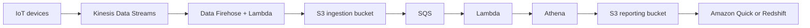

# Case Study Big Data Ingestion Pipeline

Requirements:

- We want the ingestion pipeline to be fully serverless.
- We want to collect data in real time and transform that data.
- We want to query the transformed data using SQL.
- The reports created using the queries should be in [[Amazon S3|S3]].
- Reported data should be loaded into a warehouse and we want to create dashboards.

**Streaming**

IoT devices send real-time data to [[Kinesis Data Streams]]. Data is periodically sent to [[Amazon Data Firehose]], which can trigger [[AWS Lambda]] for processing and then store it in S3 (Ingestion Bucket).

**Processing**

The data may go through [[Amazon SQS|SQS]] before further processing by another Lambda function. The processed data is analyzed using [[Amazon Athena]], with results stored in the Reporting Bucket.

**Analytics**

The data in the Reporting Bucket or [[Amazon Redshift|Redshift]] can be visualized using [[Amazon Quick|QuickSight]] or further analyzed in Redshift.

---
**Up:** [[Architecture Patterns]]
