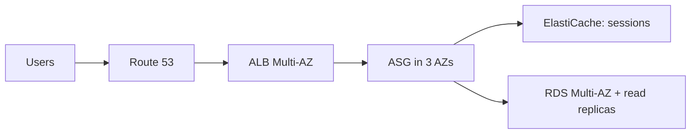

# Case Study Clothes Store App

Requirements:

- It allows people to buy clothes online.
- There is a shopping cart and users should not lose their shopping cart.
- Website can handle hundreds of users at the same time.
- We need to scale, maintain horizontal scalability and keep our web application as [[Stateless and Stateful Workloads|stateless]] as possible.
- Users should have their details in a database.

**Architecture**

We can use basic architecture with [[Amazon Route 53|Route 53]], [[Elastic Load Balancing|ELB]] (Multi-AZ) and [[Amazon EC2 Auto Scaling|ASG]] (3 AZ).

**Session**

We could use [[ELB Sticky Sessions|sticky sessions]] to keep the shopping cart, but that makes instances stateful and can unbalance the load. Using web cookies is better but we have security risks. The best way to save session data is to store it in [[Amazon ElastiCache|ElastiCache]].

**Database**

We can store user data in [[Amazon RDS|RDS]]. Because there are hundreds of users we can use [[RDS Read Replicas]] to scale reads (there is alternative using [[Caching Strategies|Lazy Loading]] pattern with ElastiCache).

**Availability**

Using Multi-AZ RDS deployment can be used for [[Disaster Recovery Strategies|disaster recovery]].

**Security**

Open HTTP/HTTPS to 0.0.0.0/0 for users. We need to restrict traffic to [[Amazon EC2|EC2]] [[Security Groups|security group]] from the load balancer and restrict traffic to ElastiCache and RDS security groups from the EC2 security group.

---
**Up:** [[Architecture Patterns]]
