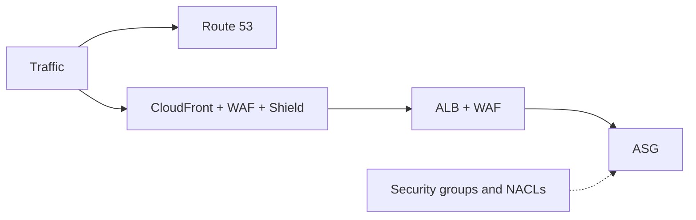

# Case Study DDoS Protection

**[[AWS Global Infrastructure|Edge Location]] Mitigation**

BP1 - [[Amazon CloudFront|CloudFront]] ⇒ Web application delivery at the edge and we are protected from DDoS common attacks (SYN floods, UDP reflection…).

BP1 - [[AWS Global Accelerator|Global Accelerator]] ⇒ Access our application from the edge. We can integrate it with Shield for DDoS protection.

BP3 - [[Amazon Route 53|Route 53]] ⇒ It has DDoS protection mechanism.

**Best Practices for DDoS Mitigation**

Infrastructure layer defense (BP1, BP3, BP6) ⇒ Protects [[Amazon EC2|EC2]] against high traffic.

EC2 with [[Amazon EC2 Auto Scaling|ASG]] (BP7) ⇒ Helps in case of sudden traffic surges including a flash crowd or DDoS attack.

[[Elastic Load Balancing|ELB]] (BP6) ⇒ Scales with the traffic increase and will distribute the traffic to many EC2 instances.

**Application Layer Defense**

Detect & filter malicious web requests (BP1, BP2) ⇒ CloudFront cache static content and serve it from the edge locations, protecting our backend. [[AWS WAF|WAF]] is used on top of CloudFront and [[Application Load Balancer|ALB]] to filter and block requests based on request signatures.

[[AWS Shield|Shield Advanced]] (BP1, BP2, BP6) ⇒ Shield Advanced automatically creates, evaluates and deploys WAF rules to mitigate layer 7 attacks.

**Attack Surface Reduction**

Obfuscating AWS resources (BP1, BP4, BP6) ⇒ We can hide our backend resources ([[AWS Lambda|Lambda functions]], EC2 instances)

Security groups and [[Network ACLs]] (BP5) ⇒ We can filter traffic based on specific IP at the [[Amazon VPC|subnet]] or [[Elastic Network Interface|ENI]] level. Elastic IP are protected by Shield Advanced.

Protecting API endpoints (BP4) ⇒ Hide our backend. If we use edge-optimized mode or CloudFront + regional mode we can get more control for DDoS protection. Also if we add WAF on top of it then we can get filtering of any HTTP request.

## Exam tasks
- [[Task 1.2 Design secure workloads and applications]]

---
**Up:** [[Architecture Patterns]]
