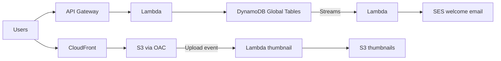

# Case Study MyBlog Serverless Website

Requirements:

- Website should scale globally.
- Blogs are rarely written, but often read.
- Some of the website is purely static files, the rest is a dynamic REST API.
- Caching must be implement where possible.
- Any new users that subscribes should receive a welcome email.
- Any photo uploaded to the blog should have a thumbnail generated.

**Serving static content, globally and securely**

We can store our static content in [[Amazon S3|S3]] and we can use [[Amazon CloudFront|CloudFront]] to serve it globally. To secure it we will add [[CloudFront Origins|Origin Access Control]] which will ensure that our S3 bucket can only be accessed by CloudFront. For this we will add a [[S3 Access Control|bucket policy]] to only authorize the CloudFront distribution.

**Serverless REST API**

We will have REST HTTPS which will go through [[Amazon API Gateway|API Gateway]], invoking a [[AWS Lambda|Lambda function]] and query/read from [[Amazon DynamoDB|DynamoDB]] (can use [[DynamoDB Accelerator|DAX]] for cache). If we go global we can use [[DynamoDB Global Tables]].

**Welcome Email**

For user welcome email we can use DynamoDB Stream which will invoke a Lambda function (need [[IAM Users Groups and Roles|IAM role]]) which will trigger [[Amazon SES|SES]] to send an email.

**Thumbnail Generation**

When image is uploaded we need to store it in S3 bucket (can use again OAC and CloudFront - [[S3 Performance|Transfer Acceleration]]). Uploading to S3 will trigger Lambda which will create thumbnail and store it in another or same S3 bucket.

---
**Up:** [[Architecture Patterns]]
