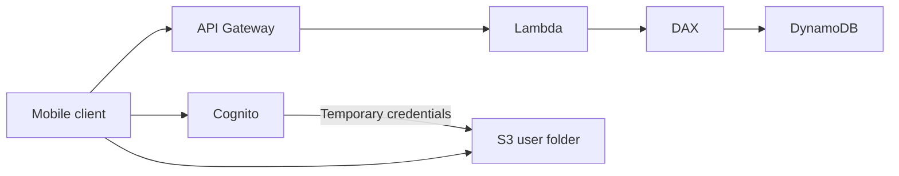

# Case Study MyTodoList Mobile App

Requirements:

- Expose as REST API with HTTPS.
- Serverless architecture.
- Users should be able to directly interact with their own folder in [[Amazon S3|S3]].
- Users should authenticate through a managed serverless service.
- Users can write and read to-dos, but they mostly read them.
- The database should scale and have some high read throughput.

**REST API Layer**

The client calls [[Amazon API Gateway|API Gateway]] over HTTPS, which invokes [[AWS Lambda|Lambda]], which reads and writes [[Amazon DynamoDB|DynamoDB]].

**Giving Users Access to S3**

We will use [[Amazon Cognito|Cognito]] to generate us temporary credentials so we can use S3 to store and retrieve files.

**High Read Throughput**

We can use [[DynamoDB Accelerator|DAX]] as a caching layer, so reads will be cached and DynamoDB will not need many RCU. Another alternative is to cache responses at API Gateway level.

---
**Up:** [[Architecture Patterns]]
