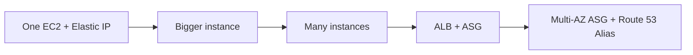

# Case Study WhatsTheTime App

Requirements:

- It allows people to know what time it is.
- We don't need a database.
- Start small and can accept downtime.
- We want to fully scale vertically and horizontally, no downtime.

The source's architecture was an image. It grows through these stages:

---
**Up:** [[Architecture Patterns]]
