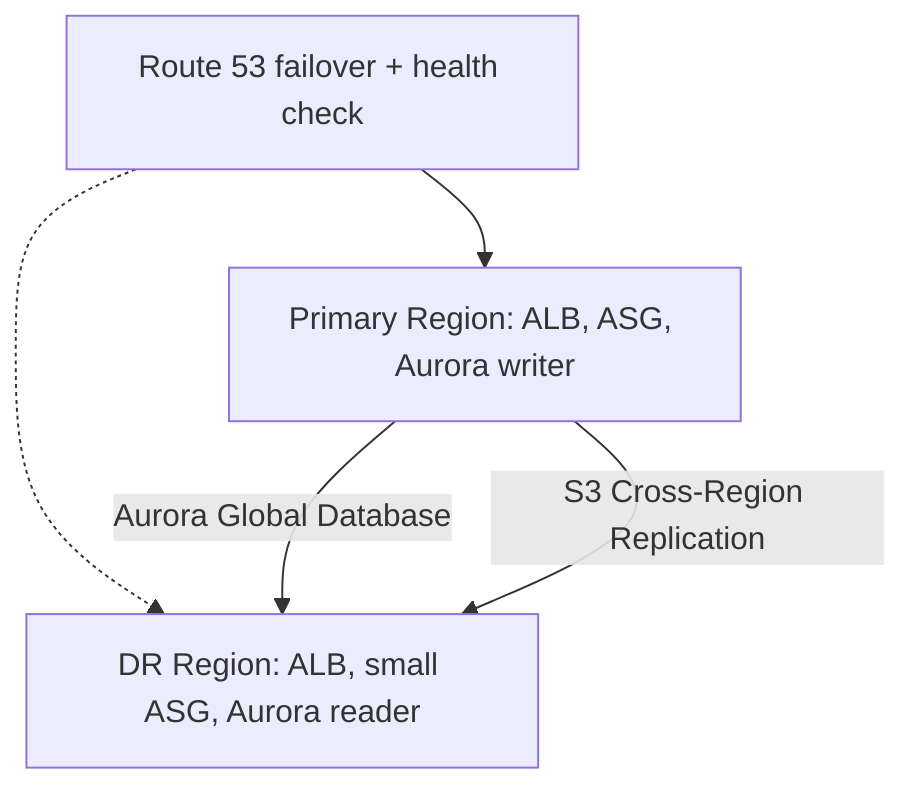

# Pattern Multi-Region Active-Passive

See [[Disaster Recovery Strategies]].

## Exam tasks
- [[Task 2.2 Design highly available and or or fault-tolerant architectures]]

---
**Up:** [[Architecture Patterns]]
