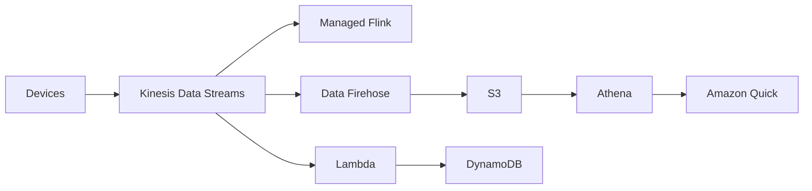

# Pattern Streaming Analytics

See [[Case Study Big Data Ingestion Pipeline]].

## Exam tasks
- [[Task 3.5 Determine high-performing data ingestion and transformation solutions]]

---
**Up:** [[Architecture Patterns]]
